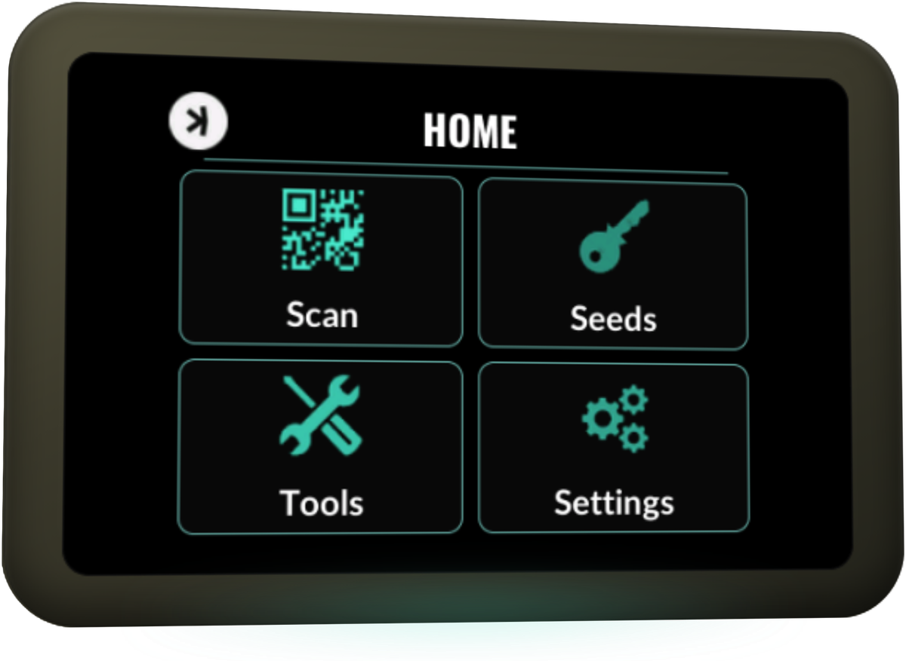
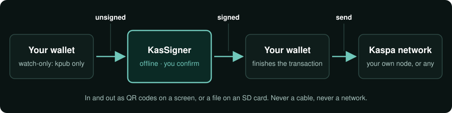

<!--
// KasSigner — Air-gapped offline signing device for Kaspa
// Copyright (C) 2025-2026 KasSigner Project (kassigner@proton.me)
//
// This program is free software: you can redistribute it and/or modify
// it under the terms of the GNU General Public License as published by
// the Free Software Foundation, either version 3 of the License, or
// (at your option) any later version.
//
// This program is distributed in the hope that it will be useful,
// but WITHOUT ANY WARRANTY; without even the implied warranty of
// MERCHANTABILITY or FITNESS FOR A PARTICULAR PURPOSE. See the
// GNU General Public License for more details.
//
// You should have received a copy of the GNU General Public License
// along with this program. If not, see <https://www.gnu.org/licenses/>.
-->

  <picture>
    <source media="(prefers-color-scheme: light)" srcset="docs/images/logo-light.svg">
    
  </picture>

<h3 align="center">The first stateless, DIY, air-gapped signer for Kaspa.</h3>

  Off-the-shelf ESP32 boards. Open, reproducible firmware. Keys that only you hold.

  

  <a href="#new-to-signers">New to signers?</a> ·
  <a href="#why-kassigner">Why KasSigner</a> ·
  <a href="#find-your-way">Find your way</a> ·
  <a href="crates/kassigner-sdk/README.md">SDK</a> ·
  <a href="https://kassigner.org"><b>kassigner.org</b></a>

> [!WARNING]
> **Mainnet only.** There is no testnet mode, on the units or in the SDK.

## What KasSigner is

KasSigner turns a standard ESP32 development board, the kind sold for every
sort of electronics project, into a signer for [Kaspa](https://kaspa.org): a
small, offline device that holds your keys while you use them, shows you every
transaction, and signs only what you approve.

You buy the board, flash the firmware yourself, check it, and lock it with
your own key if you choose. No company stands between you and your funds, and
nothing about the board says it will ever hold a key.

Until you lock it, a unit runs whatever is flashed to it over USB: use it for
testing, and lock it before trusting it with a seed.

## New to signers?

Your Kaspa is controlled by one secret: a **seed**, 12 or 24 words. Whoever
has the seed has the funds. A wallet app keeps that secret on a phone or
computer that is online all day.

A **signer** splits the job in two. Your wallet keeps only your public key: it
sees your balance and builds transactions, but it cannot spend. The signer
holds the seed, never goes online, and adds the signature.

  

Your wallet hands KasSigner the transaction data, as QR codes on a screen or a
file on an SD card. KasSigner shows you every output on its own screen and
signs only after you confirm. The signed data goes back the same way, and your
wallet sends the transaction to the network. Always check on the KasSigner
screen: it shows what is in the transaction, not what the wallet claims.

## Why KasSigner

**Nothing to target in the supply chain.** A device sold for crypto marks its
buyer, and its firmware arrives from someone else's hands. A KasSigner unit
starts as a general-purpose board from an electronics shop, blank of anything
crypto. You flash it, compare the firmware hash on its screen with the signed
list, and can lock it so it runs only firmware signed with your key. No key of
ours is ever trusted on your unit.

**No company, no data.** No account, no vendor app, no cloud, no server of
ours. Nobody holds a list of KasSigner owners, because there is nothing to
register and nothing to buy from us.

**Cold and stateless.** The unit's radios stay off from boot: data moves only
as QR codes on a screen or files on an SD card. Nothing is ever written to its
flash: you load your seed when you need it, from a SeedQR, your words, an
encrypted card backup or a photo, and power-off erases it. A unit at rest
holds nothing to steal.

**Open, so you can check it.** Every line is open source, and the firmware is
100% Rust on bare metal, with no operating system underneath. The release
builds byte for byte in a pinned Docker image, so anyone can rebuild it and
compare. Knowledge is security: the more of KasSigner you understand, the less
you need to trust anyone, us included.

**Loyal to Kaspa.** Kaspa's proof-of-work BlockDAG already sets the rules.
KasSigner follows rusty-kaspa and the published BIPs, adds no rules of its own,
and signs mainnet only.

## What it does

- **Seeds**: made from the unit's own sensors or from dice; BIP39
  passphrase, BIP85, SeedQR, six seed slots.
- **Signing**: KasSigner's KSPT and rusty-kaspa's PSKB, single key, multisig,
  KCC-3 addresses (still a proposal), Time-Locked Savings, Sign Message.
- **Backups**: encrypted SD card files, and your seed hidden inside ordinary
  photos, printed on paper if you like.
- **Protection**: Secure Boot with your own key, self-tests at every boot, a
  wipe after 4 minutes idle or on a 6-second hold of the logo.

## The units

| Board | Screen | Power | Camera |
| --- | --- | --- | --- |
| M5Stack CoreS3 | 320×240 | Battery | Built in |
| Waveshare ESP32-S3-Touch-LCD-2 | 320×240 | USB | An OV5640 module you add |
| Waveshare ESP32-P4-WIFI6-Touch-LCD-3.5, chip revision 1.3 only | 480×320 | Battery | Built in |

ESP32 chips, made by Espressif, run millions of everyday devices. These three
boards add a touch screen, an SD card slot and a camera, which is all a signer
needs. One firmware runs on all of them, so units of different kinds sign
together, multisig included. A P4 board with a v3.x chip is not supported: the
firmware stops at boot on it.

## Where it comes from

KasSigner began in March 2026 as a DIY signer on the ESP32-S3. Its second
release, three days later, brought the first air-gapped multisig on Kaspa
mainnet. Steganographic backups, covenants and several security reviews
followed through v1.0.7.

v1.1.0 is a fresh start: all new code, built as fifteen Rust crates, a third
board on the ESP32-P4, and an SDK so any Kaspa wallet can work with a unit.

## Find your way

| I want to... | Go to |
| --- | --- |
| Understand KasSigner from the start | The User Manual, a PDF in every release |
| Build and set up my own unit | [docs/INSTALL.md](docs/INSTALL.md) |
| Lock my unit with my own key | [docs/LOCKING.md](docs/LOCKING.md) |
| Print a case for the Waveshare ESP32-S3 board | [hardware/case-waveshare](hardware/case-waveshare/README.md) |
| Use it day to day | The User Manual |
| Use it with a phone wallet today | [KaPay](https://home.kachat.app/), the wallet of the KaChat suite: add the unit's kpub to its Cold Storage |
| Try a unit before my wallet supports it | [kassigner.org](https://kassigner.org), the project's test tool. The copy hosted there cannot send; to use it in full, run your own copy from [its repository](https://github.com/InKasWeRust/kassigner-test-tools) |
| Print cards to write my seed on | [docs/KasSigner_Seed_Cards.pdf](docs/KasSigner_Seed_Cards.pdf) |
| Hide my seed in a photo | [docs/STEGANOGRAPHY.md](docs/STEGANOGRAPHY.md) |
| Add KasSigner to my wallet | [crates/kassigner-sdk](crates/kassigner-sdk/README.md) |
| Check how it protects me | [SECURITY.md](SECURITY.md) |
| Rebuild a release and compare | [REPRODUCIBLE.md](REPRODUCIBLE.md) |
| Build from source or contribute | [CONTRIBUTING.md](CONTRIBUTING.md) |
| See what changed | [CHANGELOG.md](CHANGELOG.md) |
| Report a vulnerability | Email **kassigner@proton.me**, subject `[SECURITY]` |

## For wallet builders

The SDK lets any Kaspa wallet use KasSigner as its signer. It imports what a
unit hands over, builds requests in KSPT or PSKB, reads the signed replies and
finishes the transaction, through the user's own rusty-kaspa node or a REST
server. It holds no seed and can never reach the key crate.

| Language | Crate |
| --- | --- |
| Rust | [`kassigner-sdk`](crates/kassigner-sdk/README.md#packages), [`kassigner-sdk-host`](crates/kassigner-sdk/README.md#packages) |
| JavaScript, TypeScript | [`kassigner-sdk-wasm`](crates/kassigner-sdk/README.md#packages) |
| Swift, Kotlin, Python | [`kassigner-sdk-ffi`](crates/kassigner-sdk/README.md#packages) |

**KaPay**, the wallet of the [KaChat](https://home.kachat.app/) suite (Android,
and iOS in beta), works with KasSigner: its Cold Storage watches the unit's
kpub and sends through the unit.

## Inside the repository

Each crate sits at a level that says what it may hold, and depends only on its
own level and those below, never above. Adding a board means adding one crate.

| Level | Crates | Holds |
| --- | --- | --- |
| 0 | `kassigner-kaspa`, `-qr`, `-jpeg`, `-fat32` | What others specified: Kaspa's rules, QR, JPEG, FAT32 |
| 1 | `kassigner-protocol` | What this project designed: KSPT, its transport, containers |
| 2 | `kassigner-crypto` | Key material, out of the SDK's reach |
| 3 | `kassigner-hal*`, `kassigner-fw`, `kassigner-sdk*` | The boards, the unit's behaviour, the SDK |
| 4 | `kassigner-signer` | The firmware |

[`release/`](release) holds the pinned Docker build, [`spec/`](spec) the test
vectors and [`testkit/`](testkit) the test code the crates share, the fuzz loop
among it.

## Licence

The firmware is [GPL-3.0-or-later](COPYING): free for everyone, and it stays
that way. So are `kassigner-crypto` and `kassigner-fat32`. The SDK and the
crates it is built from are [MPL-2.0](crates/kassigner-sdk/LICENSE), so any
wallet can integrate KasSigner.

---

  Built for Kaspa. Don't trust, verify. Sign offline. Broadcast sovereign.

